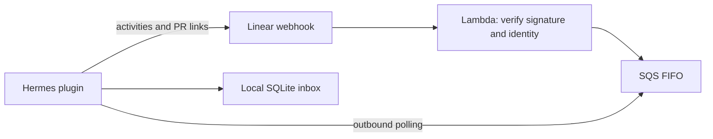

# Linear agent sessions

This optional integration connects the generated gateway to mentions, issue delegations, and follow-up messages in Linear. It uses the signed upstream Harness image unchanged. Nothing is deployed or enabled by default; the plugin stays outside `agent_home/` until explicitly installed.

The plugin targets the Hermes v0.22.2 APIs shipped in `hermes-1.12.0`. The base template pins `hermes-1.9.11`; first use [manage-dispatch](../../.agents/skills/manage-dispatch/SKILL.md) Mode 4 to select and verify `hermes-1.12.0` before installing this plugin. Keep the selected tag in the main template so subsequent updates preserve it. Recheck compatibility before upgrading: session task tracking and final-delivery metadata are internal Hermes interfaces. Unit tests use simulated transports; validate a disposable Linear issue before giving the deployment production work.

## Architecture



The public Lambda Function URL accepts only signed, fresh events for the configured organization and app. The gateway polls SQS outbound; it needs no inbound port. Each Linear session maps to a Hermes session. Explicit Linear user IDs authorize work, follow-ups, status, and Stop signals.

The inbox commits before queue deletion and deduplicates event IDs. Queued work survives restarts. A run that had already started is reported as interrupted, requiring a fresh request rather than replaying potentially completed tool side effects. Run only one consumer against this inbox. Keep `HERMES_HOME` on a local filesystem, such as retained EBS; SQLite WAL must not live on EFS/NFS. Back up the full agent state.

## 1. Configure a Linear app

Create a private app for your workspace with [client credentials enabled](https://linear.app/developers/oauth-2-0-authentication#client-credentials-tokens). Configure it as an agent following [Linear's setup guide](https://linear.app/developers/agents). Record the organization ID and app **user** ID (the latter is not the OAuth client ID).

The plugin requests `read,write,app:assignable,app:mentionable,webhook`. Every other token issuer for this app must use the same scopes: a different scope set invalidates existing app tokens. Tokens stay in memory, renew before expiry, and refresh once on HTTP 401. This integration is for one workspace; a public multi-workspace OAuth service needs a separate installation and credential model.

Complete [setup-dispatch](../../.agents/skills/setup-dispatch/SKILL.md) first, including installation of the mapped-only `aws_ssm` secret source. Activate the generated project's mise environment before AWS commands. Use the setup skill's secure-input procedure to write `/dispatch/LINEAR_WEBHOOK_SIGNING_SECRET` as an SSM **SecureString**, encrypted with `alias/dispatch-ssm`. The receiver reads this parameter; do not add it to the gateway's secret mappings. Store all six gateway values listed below as SecureStrings under `/dispatch/` with the same key. Avoid putting secret values in committed configuration, shell history, logs, or CloudFormation parameters.

## 2. Deploy the receiver and queue

The integration is a separate `dispatch-linear` stack in the main gateway's account and region. Its consumer policy attaches to the existing `dispatch-task` role. The main stack's networking, EBS volume, and Slack configuration remain managed by the base setup skill.

An administrator applies the generated `dispatch-deploy-policy.json` to the deployer (it includes the side stack's scope), then attaches the **additional** CloudFormation execution policy:

```bash
aws iam put-role-policy --role-name dispatch-cfn-exec \
  --policy-name linear-integration \
  --policy-document file://integrations/linear/cfn-policy.json
```

Keep the execution role's existing base policy: it supplies IAM role and CloudWatch Logs lifecycle permissions. The supplemental policy grants Lambda and SQS lifecycle permissions only for this integration's names. These administrator actions do not run with the restricted deployer identity.

From the generated project root, use the deployer identity:

```bash
python3 integrations/linear/render_template.py > /tmp/dispatch-linear.json
LINEAR_CFN_ROLE_ARN=$(aws cloudformation describe-stacks --region us-east-1 \
  --stack-name dispatch --query 'Stacks[0].RoleARN' --output text)
LINEAR_KMS_KEY_ARN=$(aws cloudformation describe-stacks --region us-east-1 \
  --stack-name dispatch \
  --query "Stacks[0].Outputs[?OutputKey=='KmsKeyArn'].OutputValue | [0]" --output text)

aws cloudformation deploy --region us-east-1 \
  --stack-name dispatch-linear --template-file /tmp/dispatch-linear.json \
  --role-arn "$LINEAR_CFN_ROLE_ARN" --capabilities CAPABILITY_NAMED_IAM \
  --parameter-overrides ClawName=dispatch \
    OrganizationId=YOUR_ORGANIZATION_UUID AppUserId=YOUR_APP_USER_UUID \
    SigningSecretParameter=/dispatch/LINEAR_WEBHOOK_SIGNING_SECRET \
    SigningSecretKeyArn="$LINEAR_KMS_KEY_ARN"

aws cloudformation describe-stacks --region us-east-1 \
  --stack-name dispatch-linear --query 'Stacks[0].Outputs'
```

Require nonempty `LINEAR_CFN_ROLE_ARN` and `LINEAR_KMS_KEY_ARN` values (neither `None` nor `null`) before deploying. The key's IAM-enabled policy allows the receiver's scoped decrypt permission through SSM. The stack creates encrypted FIFO and dead-letter queues, a receiver, and a public Function URL. Authentication is raw-body HMAC verification in the handler.

Set the app's webhook URL to the `WebhookUrl` output and enable **Agent session events** after the gateway is ready. The receiver checks the raw-body signature, a 60-second timestamp window, and both envelope/session identities before enqueueing. See [Linear webhook verification](https://linear.app/developers/webhooks).

## 3. Install the plugin and configure Hermes

1. Copy `integrations/linear/plugin/` to `agent_home/plugins/linear-agent/` in the generated project. Use [manage-dispatch](../../.agents/skills/manage-dispatch/SKILL.md) Mode 1 to overlay it into persisted `HERMES_HOME` as the workload user. The image provides `boto3`; verify the plugin dependency check succeeds.
2. Merge the **keys** in `integrations/linear/config.yaml` into `agent_home/config.yaml`, preserving existing `secrets.sources`, SSM mappings, and other platform settings. The fragment does not set `plugins.enabled` because config merge replaces lists.
3. Fetch the live config using Mode 3. Form the union of its existing `plugins.enabled` list and any curated enabled plugins, then append `linear-agent` once. Keep `aws_ssm` and every other enabled plugin. Put that complete list in the curated config, inspect the merge diff, and apply it with Mode 3. Do not replace the live config with this fragment.
4. Check `secrets.sources` includes `aws_ssm`, `secrets.aws_ssm.enabled` is true, and all six Linear mappings are present. None of the config files contain credentials.

Supply these values through the mapped SSM source (use SecureString for every mapped value, including IDs and queue URL):

| Variable | Value |
|---|---|
| `AWS_REGION` | Receiver/queue region, such as `us-east-1` |
| `LINEAR_AGENT_QUEUE_URL` | Stack's `QueueUrl` output |
| `LINEAR_ORGANIZATION_ID` | Same organization UUID as the receiver |
| `LINEAR_APP_USER_ID` | Same app user UUID as the receiver |
| `LINEAR_ALLOWED_USERS` | Comma-separated Linear user UUIDs explicitly allowed to run work; no wildcard |
| `LINEAR_CLIENT_ID` | OAuth app client ID |
| `LINEAR_CLIENT_SECRET` | OAuth app client secret |

Use the gateway's AWS role credentials for SQS. Restart the gateway after installing the plugin or changing configuration. Confirm the plugin loaded and the Linear adapter connected before enabling webhook delivery.

This plugin transports requests and responses; it does not add issue-management tools, repository credentials, or deployment permissions. Configure the Hermes tools appropriate for your workspace separately. Existing Linear MCP authentication is independent; this integration does not patch Hermes's MCP OAuth transport. Any additional client-credentials issuer for the same app must keep the scope set above.

## 4. Verify on a disposable issue

Mention or delegate to the app as an allowed user, then reply in the agent session. Verify an acknowledgement, a final response, and a continued conversation. Ordinary ticket text cannot invoke Hermes gateway slash commands; only an authenticated Stop signal takes the control path.

During a longer task, send `/status` or `any updates?`. These standalone requests return recorded progress and queued work without calling a model or waiting for the running task. Mixed requests such as “status, then fix the tests” stay queued as work. Status still depends on healthy queue/API connectivity.

Interim messages carry findings and blockers. The prompt asks the agent to report a verified existing fix immediately, distinguish verification from deployment, and reuse evidence. These are instructions to the model, not guaranteed latency bounds. Temporary liveness activities use Linear's `ephemeral` flag, so repeated heartbeats do not accumulate in the conversation. Public GitHub PR URLs are also attached to the session as external links.

Exercise Stop, a gateway restart during work, and a request from a non-allowlisted user. Verify that interrupted work is not replayed and unauthorized requests do not start a model. Linear expects the webhook response within five seconds and an initial activity within ten seconds; verify these timings in your deployment, including cold starts. A paused consumer or API outage can exceed them.

## Operations and removal

Queue retention is 14 days; after eight failed receipts a message moves to the dead-letter queue. Monitor receiver errors, queue age, and dead-letter messages. Investigate poison messages before redriving them. Logs omit webhook bodies and credentials, but the queue and local inbox contain issue context and responses; restrict access and include them in your retention policy. The integration does not automatically prune the local inbox.

Client-secret rotation requires updating the gateway environment and restarting it. The receiver caches its signing secret per Lambda execution environment: rotate the Linear secret and SSM value together, then recycle/redeploy the receiver and verify a signed delivery. Restarting just Hermes does not refresh that cache.

To remove the integration:

1. Disable app webhook delivery. Wait for active work to finish or explicitly cancel it before stopping the consumer.
2. Remove `linear-agent` from both live and curated `plugins.enabled` lists, and remove the six Linear SSM mappings and `display.platforms.linear` from both configs. Remove `agent_home/plugins/linear-agent` locally and its persisted counterpart using manage Mode 2. Mode 1 is additive and Mode 3 never deletes keys, so an overlay/merge alone does not remove these settings. Preserve other plugins and restart the gateway; verify Slack still connects.
3. Back up required queue/inbox data. Delete the side stack **before deleting the main stack**; its consumer policy references the main task role, and its receiver uses the main KMS key:

   ```bash
   aws cloudformation delete-stack --region us-east-1 --stack-name dispatch-linear
   aws cloudformation wait stack-delete-complete --region us-east-1 --stack-name dispatch-linear
   ```

4. After successful deletion, an administrator removes only the `linear-integration` inline policy from `dispatch-cfn-exec`. Remove only the seven Linear SSM parameters when retiring the integration, and revoke the app credentials. The local inbox remains at `$HERMES_HOME/linear-agent-inbox.db`; retain or remove it according to your data policy. Main-stack teardown can now continue using [teardown-dispatch](../../.agents/skills/teardown-dispatch/SKILL.md).

## Local checks

```bash
python3 -m unittest discover -s integrations/linear/tests -v
python3 integrations/linear/render_template.py > /tmp/dispatch-linear.json
```

The tests cover signature and identity checks, token renewal, durable deduplication, interrupted runs, status bypass, and response delivery. They do not provision AWS resources or call Linear or a model.
